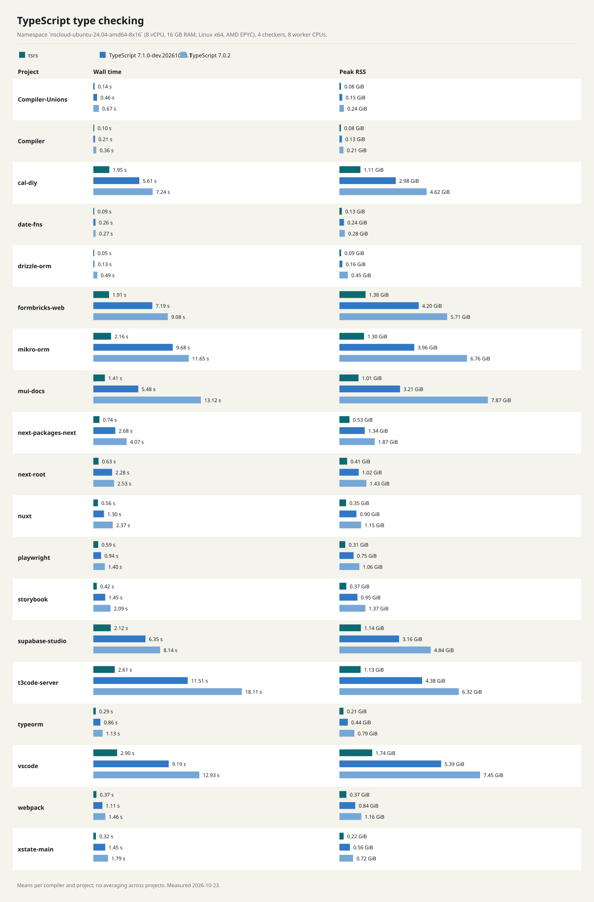
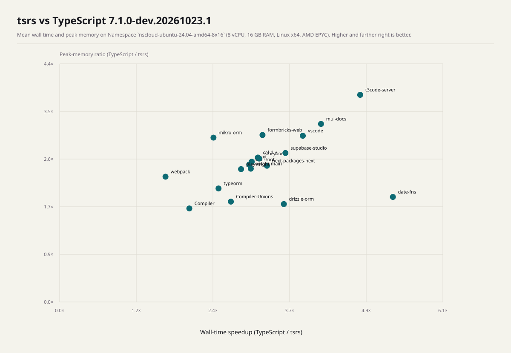
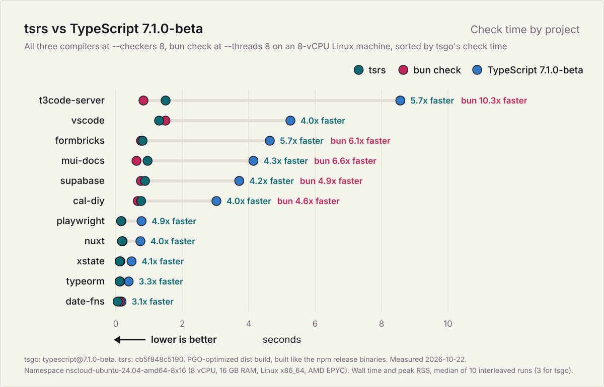
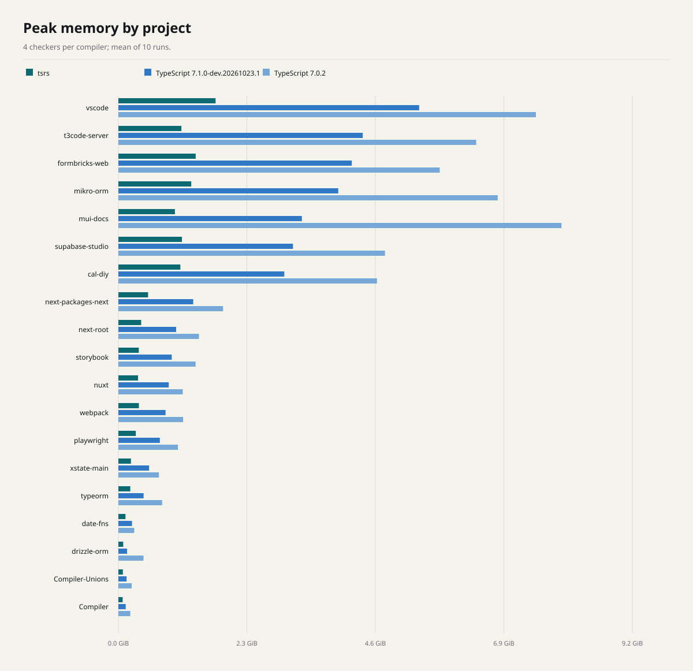

# Benchmark results

Measured 2026-10-23T09:53:36.148Z on Namespace `nscloud-ubuntu-24.04-amd64-8x16` (8 vCPU, 16 GB RAM, Linux x64, AMD EPYC).

Arithmetic means of 10 runs after 3 warmups per compiler and project. Projects are never averaged together.

4 checkers and 8 worker CPUs per compiler.

tsrs commit: `a5f803b88a47821d2923ab9b006a29a2080ba2f6`.

[Benchmark run and raw-data artifacts](https://github.com/oxc-project/tsrs/actions/runs/39934140192).

[Methodology](README.md).

<picture>
  <source media="(prefers-color-scheme: dark)" srcset="large-projects-dark.svg">
  
</picture>

<picture>
  <source media="(prefers-color-scheme: dark)" srcset="per-project-time-dark.svg">
  
</picture>

<picture>
  <source media="(prefers-color-scheme: dark)" srcset="per-project-memory-dark.svg">
  
</picture>

| Project | Compiler | Wall time | Peak memory | Instructions | Files | Diagnostics |
| --- | --- | ---: | ---: | ---: | ---: | ---: |
| Compiler-Unions | tsrs | 0.108 s | 0.080 GiB | 3,713,850,873 | 48 | 41 |
| Compiler-Unions | TypeScript 7.1.0-dev.20261023.1 | 0.294 s | 0.148 GiB | 10,485,487,951 | 48 | 41 |
| Compiler-Unions | TypeScript 7.0.2 | 0.546 s | 0.240 GiB | 16,081,893,887 | 48 | 41 |
| Compiler | tsrs | 0.114 s | 0.076 GiB | 2,066,207,065 | 53 | 43 |
| Compiler | TypeScript 7.1.0-dev.20261023.1 | 0.248 s | 0.131 GiB | 4,624,300,938 | 53 | 43 |
| Compiler | TypeScript 7.0.2 | 0.436 s | 0.210 GiB | 8,417,446,244 | 53 | 43 |
| cal-diy | tsrs | 1.286 s | 1.109 GiB | 46,386,275,279 | 10173 | 136 |
| cal-diy | TypeScript 7.1.0-dev.20261023.1 | 4.274 s | 3.004 GiB | 146,993,720,671 | 10173 | 136 |
| cal-diy | TypeScript 7.0.2 | 5.934 s | 4.648 GiB | 216,918,908,890 | 10166 | 136 |
| date-fns | tsrs | 0.060 s | 0.126 GiB | 1,735,677,806 | 2277 | 1 |
| date-fns | TypeScript 7.1.0-dev.20261023.1 | 0.173 s | 0.242 GiB | 5,977,052,071 | 2277 | 1 |
| date-fns | TypeScript 7.0.2 | 0.188 s | 0.286 GiB | 6,802,349,227 | 2270 | 1 |
| drizzle-orm | tsrs | 0.045 s | 0.087 GiB | 1,016,670,032 | 1554 | 2 |
| drizzle-orm | TypeScript 7.1.0-dev.20261023.1 | 0.139 s | 0.155 GiB | 3,490,564,054 | 1554 | 2 |
| drizzle-orm | TypeScript 7.0.2 | 0.541 s | 0.440 GiB | 15,827,192,500 | 1554 | 2 |
| formbricks-web | tsrs | 1.291 s | 1.383 GiB | 50,018,036,722 | 10458 | 0 |
| formbricks-web | TypeScript 7.1.0-dev.20261023.1 | 5.112 s | 4.228 GiB | 176,525,860,130 | 10458 | 0 |
| formbricks-web | TypeScript 7.0.2 | 6.079 s | 5.749 GiB | 229,200,125,857 | 10451 | 0 |
| mikro-orm | tsrs | 1.511 s | 1.305 GiB | 64,056,917,401 | 2820 | 11 |
| mikro-orm | TypeScript 7.1.0-dev.20261023.1 | 5.298 s | 3.978 GiB | 236,282,681,175 | 2820 | 11 |
| mikro-orm | TypeScript 7.0.2 | 7.406 s | 6.705 GiB | 378,789,124,827 | 2820 | 2 |
| mui-docs | tsrs | 1.930 s | 1.014 GiB | 57,155,731,045 | 16766 | 0 |
| mui-docs | TypeScript 7.1.0-dev.20261023.1 | 5.053 s | 3.291 GiB | 215,088,829,061 | 16766 | 0 |
| mui-docs | TypeScript 7.0.2 | 15.210 s | 7.870 GiB | 563,915,884,251 | 16766 | 0 |
| next-packages-next | tsrs | 0.558 s | 0.531 GiB | 19,603,793,062 | 2898 | 3 |
| next-packages-next | TypeScript 7.1.0-dev.20261023.1 | 2.328 s | 1.329 GiB | 61,863,104,125 | 2898 | 3 |
| next-packages-next | TypeScript 7.0.2 | 3.105 s | 1.886 GiB | 85,184,921,487 | 2891 | 3 |
| next-root | tsrs | 0.358 s | 0.407 GiB | 15,432,670,007 | 4001 | 4 |
| next-root | TypeScript 7.1.0-dev.20261023.1 | 1.226 s | 1.031 GiB | 42,655,592,401 | 4001 | 4 |
| next-root | TypeScript 7.0.2 | 1.442 s | 1.441 GiB | 57,860,083,806 | 3994 | 7 |
| nuxt | tsrs | 0.301 s | 0.352 GiB | 10,959,358,565 | 3705 | 1 |
| nuxt | TypeScript 7.1.0-dev.20261023.1 | 0.945 s | 0.908 GiB | 35,789,911,199 | 3705 | 1 |
| nuxt | TypeScript 7.0.2 | 1.161 s | 1.159 GiB | 47,111,162,192 | 3705 | 3 |
| playwright | tsrs | 0.272 s | 0.310 GiB | 9,451,825,928 | 1527 | 0 |
| playwright | TypeScript 7.1.0-dev.20261023.1 | 0.799 s | 0.750 GiB | 29,826,961,486 | 1527 | 0 |
| playwright | TypeScript 7.0.2 | 1.132 s | 1.059 GiB | 44,228,952,228 | 1520 | 0 |
| storybook | tsrs | 0.273 s | 0.364 GiB | 12,556,123,947 | 3548 | 93 |
| storybook | TypeScript 7.1.0-dev.20261023.1 | 1.129 s | 0.958 GiB | 40,160,221,929 | 3548 | 93 |
| storybook | TypeScript 7.0.2 | 1.416 s | 1.379 GiB | 64,291,672,273 | 3541 | 93 |
| supabase-studio | tsrs | 1.304 s | 1.137 GiB | 56,131,763,303 | 12553 | 9 |
| supabase-studio | TypeScript 7.1.0-dev.20261023.1 | 5.203 s | 3.095 GiB | 186,402,158,736 | 12553 | 9 |
| supabase-studio | TypeScript 7.0.2 | 10.041 s | 4.743 GiB | 265,073,013,601 | 12546 | 0 |
| t3code-server | tsrs | 2.028 s | 1.130 GiB | 69,806,003,106 | 2948 | 6 |
| t3code-server | TypeScript 7.1.0-dev.20261023.1 | 11.901 s | 4.324 GiB | 355,193,925,347 | 2948 | 6 |
| t3code-server | TypeScript 7.0.2 | 14.263 s | 6.406 GiB | 468,990,767,572 | 2941 | 5 |
| typeorm | tsrs | 0.187 s | 0.213 GiB | 6,870,339,140 | 3575 | 31 |
| typeorm | TypeScript 7.1.0-dev.20261023.1 | 0.517 s | 0.446 GiB | 18,502,286,065 | 3575 | 31 |
| typeorm | TypeScript 7.0.2 | 0.703 s | 0.768 GiB | 28,349,562,656 | 3575 | 31 |
| vscode | tsrs | 2.529 s | 1.738 GiB | 87,522,995,336 | 10427 | 371 |
| vscode | TypeScript 7.1.0-dev.20261023.1 | 9.561 s | 5.315 GiB | 240,017,272,636 | 10427 | 371 |
| vscode | TypeScript 7.0.2 | 8.783 s | 7.559 GiB | 308,989,182,148 | 10427 | 359 |
| webpack | tsrs | 0.321 s | 0.365 GiB | 12,509,011,758 | 1607 | 840 |
| webpack | TypeScript 7.1.0-dev.20261023.1 | 0.932 s | 0.837 GiB | 34,990,063,522 | 1607 | 840 |
| webpack | TypeScript 7.0.2 | 1.222 s | 1.157 GiB | 47,911,071,833 | 1607 | 848 |
| xstate-main | tsrs | 0.192 s | 0.224 GiB | 6,733,850,707 | 1539 | 0 |
| xstate-main | TypeScript 7.1.0-dev.20261023.1 | 0.660 s | 0.541 GiB | 20,942,947,133 | 1539 | 0 |
| xstate-main | TypeScript 7.0.2 | 0.813 s | 0.718 GiB | 27,689,876,319 | 1532 | 0 |

File counts and diagnostics were collected in separate, untimed runs.
